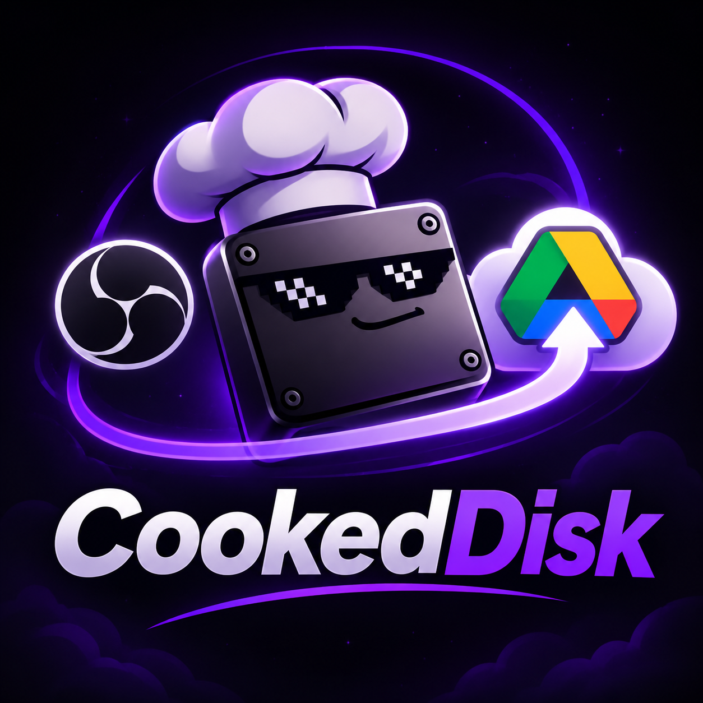
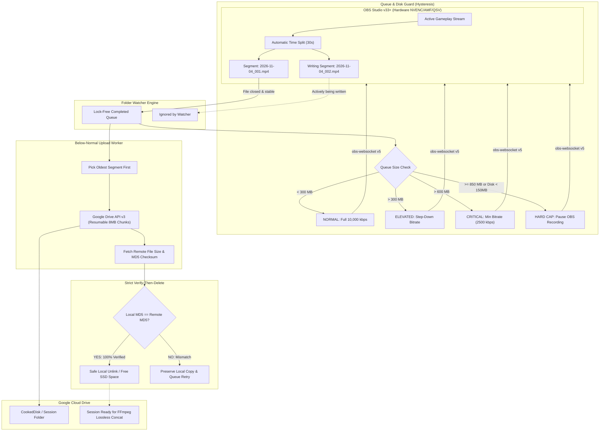

<div align="center">



# CookedDisk

### Record 100-Hour Gaming Sessions on a 1 GB Drive.
**The autonomous, low-overhead OBS Studio cloud companion that streams gameplay recordings directly to Google Drive while you play.**

[](https://github.com/ImpactG1/CookedDisk/actions/workflows/ci.yml)
[](https://github.com/ImpactG1/CookedDisk/releases)
[](https://www.python.org/)
[](https://obsproject.com/)
[-41CD52.svg?style=for-the-badge&logo=qt&logoColor=white)](https://www.qt.io/)
[](https://developers.google.com/drive)
[](https://www.microsoft.com/windows)
[-brightgreen.svg?style=for-the-badge&logo=pytest&logoColor=white)](tests/)
[](LICENSE)
[](https://github.com/ImpactG1/CookedDisk/stargazers)
[](https://github.com/ImpactG1/CookedDisk/issues)

<br/>

[**Download Installer (v1.0.0)**](https://github.com/ImpactG1/CookedDisk/releases) • [**Documentation**](#quickstart-guide) • [**Architecture**](#architecture--data-pipeline) • [**OBS Setup**](#required-obs-studio-setup) • [**Report Bug**](https://github.com/ImpactG1/CookedDisk/issues)

</div>

---

## ⚡ The Problem vs. The CookedDisk Solution

| The Typical Reality | The CookedDisk Paradigm |
|:---|:---|
| ❌ **Low C: Drive Space**: Only ~1 GB free on an NVMe SSD. A 2-hour 1080p60 session generates ~12 GB and crashes OBS mid-match with *"Disk Full"*. | ✅ **Zero Local Footprint**: Seamlessly streams short 30s segments to Google Drive in real time. Local files are purged immediately upon confirmed cloud checksum match. |
| ❌ **Dropped FPS & Game Stutter**: Background upload scripts saturate CPU threads and CPU queues, causing micro-stutters in *Apex Legends*, *Valorant*, or *Cyberpunk*. | ✅ **Below-Normal Priority Engine**: Upload worker runs at Windows `THREAD_PRIORITY_BELOW_NORMAL`. Game threads take 100% priority. 0 dropped frames. |
| ❌ **Network Flapping & Throttling**: Home internet drops from 80 Mbps to 10 Mbps when family streams Netflix, causing upload queues to back up and crash the local disk. | ✅ **Closed-Loop Adaptive Bitrate**: Listens to queue depth in real time via OBS WebSocket v5. Dynamically modulates encoder bitrate with mathematical hysteresis. |
| ❌ **Corrupted Recordings**: Hard crashes or accidental reboots leave unfinalized `.mp4` files permanently unreadable and lost. | ✅ **Hybrid MP4 & MKV Crash Immunity**: Uses fragmented segmenting. Leftover segments are recovered and prioritized automatically on reboot. |
| ❌ **Fragmented Files**: Ending up with 120 individual 30-second video clips across random folders. | ✅ **Lossless Stream Concat Tool**: Integrated one-click FFmpeg merger joins the entire multi-hour session into a pristine, single MP4 (`-c copy`) in seconds. |

---

## 🏗️ Architecture & Data Pipeline

CookedDisk operates as an autonomous, out-of-process companion alongside OBS Studio. It does not hook graphics drivers or inject code into games.



---

## 💎 Core Capabilities

### 1. Mathematical Verify-Before-Delete
CookedDisk guarantees zero data loss. Before any local file is deleted:
1. The upload worker streams the segment in 8 MB chunks via Google Drive Resumable API.
2. Upon HTTP 200 OK, the file's server-computed `md5Checksum` and byte count are retrieved from Google Drive v3 metadata.
3. The local file is hashed using chunked MD5.
4. **The local file is purged IF AND ONLY IF `local_size == remote_size` AND `local_md5 == remote_md5`.**

### 2. Dual-Threshold Hysteresis Bitrate Controller
To eliminate quality flapping (rapid toggling between high and low bitrates), CookedDisk implements state hysteresis:
- **Normal $\to$ Elevated**: Triggers when queue exceeds **300 MB**.
- **Elevated $\to$ Normal**: Only recovers after the queue drains below **200 MB**.
- **Elevated $\to$ Critical**: Triggers when queue exceeds **600 MB**.
- **Critical $\to$ Elevated**: Only recovers after the queue drains below **450 MB**.
- **Hard Cap Safety Floor**: If physical free space on `C:` drops below **150 MB**, an emergency pause command is sent over WebSocket immediately.

### 3. Background Game-First Priority
File uploads run at Windows `THREAD_PRIORITY_BELOW_NORMAL` (-1) via Win32 `kernel32.dll`. Game rendering loops, shader compilation, and mouse polling rates take absolute priority on your CPU and network scheduling.

### 4. Crash Recovery & Offline Resilience
If your internet drops out for 10+ minutes:
- CookedDisk halts upload attempts with exponential backoff and keeps recording within the disk headroom.
- If OBS or Windows crashes, CookedDisk performs a startup scan of the recording directory, identifies incomplete or un-uploaded segments, and catches up automatically.

### 5. Native Windows 11 Styling
Built strictly to modern Windows design standards:
- **Segoe UI Variable** typography with tabular numerals (`tnum`) for byte sizes, speeds, and timestamps.
- **Fluent & Lucide outline icons** rendered from vector SVGs.
- Dynamic dark/light theme switching following Windows `AppsUseLightTheme`.
- Discreet **System Tray integration** with live status tooltips and quick pause/resume toggles.

### 5. Upload Bandwidth Limiter & In-Game Ping Protection
To prevent competitive game ping spikes (e.g. in *Valorant*, *Apex*, *CS2*), CookedDisk includes configurable chunk-pacing bandwidth limits (Uncapped, 20, 30, 40, 50, or 60 Mbps). This prevents your upload channel from saturating and keeps your in-game latency low and jitter-free.

### 6. One-Click Automated OBS Configuration
Rather than hunting through menus, the **Setup check** screen includes an **"Auto-Configure OBS"** button that talks over WebSocket v5 to automatically configure Output Mode (Advanced), Hybrid MP4 format, 30-second time splitting, hardware GPU encoder, and optimal bitrate.

---

## ❓ Frequently Asked Questions

### Won't 30-second segmenting create visible cuts or ruin my video?
**No! Not at all.** Here is why:
1. **Keyframe-Aligned Splitting**: In OBS Studio, automatic time-based splitting splits on the exact nearest I-frame (keyframe) at the GOP boundary. There are **zero dropped frames, zero audio dropouts, and zero timestamp gaps** between segment $N$ and segment $N+1$.
2. **Lossless Stream Copy Concat (`-c copy`)**: When merging segments back together with CookedDisk's built-in FFmpeg tool, FFmpeg executes a binary stream copy. It does not re-encode. The resulting merged MP4 is **bit-for-bit and frame-for-frame identical** to if you had recorded a single continuous 5-hour file without splitting.
3. **Crash Insurance**: If a power outage or crash occurs, standard single-file MP4s become completely unreadable. With 30-second segments, you lose at most 1–2 seconds of gameplay.

---

## 🚀 Quickstart Guide

### Option A: Windows Installer (Recommended)
1. Grab the latest installer: [`CookedDisk_Setup_v1.0.0.exe`](https://github.com/ImpactG1/CookedDisk/releases).
2. Run the setup wizard.
3. Launch **CookedDisk** from your Start Menu or Desktop.

### Option B: Run from Source
```powershell
# Clone the repository
git clone https://github.com/ImpactG1/CookedDisk.git
cd CookedDisk

# Install dependencies
python -m pip install -r requirements.txt

# Run full test suite (22 tests)
python -m pytest tests/ -v

# Launch Desktop App
python main.py
```

---

## ⚙️ Required OBS Studio Setup

CookedDisk provides an automated **Setup check** screen in-app that verifies your settings via WebSocket. Set these up in OBS Studio once:

1. **WebSocket Server**:
   - In OBS: **Tools** $\to$ **WebSocket Server Settings**.
   - Check **Enable WebSocket server**.
   - Default Port: `4455`. Set a server password.
2. **Output Mode**:
   - In OBS: **Settings** $\to$ **Output** $\to$ Output Mode: **Advanced** $\to$ **Recording** tab.
3. **Format & Codec**:
   - **Recording Format**: Set to **Hybrid MP4** (or **MKV**). *Do not use standard unfragmented MP4.*
   - **Video Encoder**: Select a hardware encoder (**NVIDIA NVENC**, **AMD AMF**, or **Intel QuickSync**).
   - **Bitrate**: Set to **10,000–12,000 kbps** (10–12 Mbps).
4. **Automatic Splitting**:
   - Check **Automatic File Splitting**.
   - Split Method: **Split by Time**.
   - Time: **30 seconds**.
5. Match the **Recording Folder** in OBS with CookedDisk Settings.

---

## 🔑 Google Cloud OAuth Setup (One-Time)

CookedDisk uses the official Google Drive API v3 with the least-privilege `drive.file` scope (meaning it can only see and manage files that CookedDisk itself creates):

1. Visit [Google Cloud Console](https://console.cloud.google.com/) and create a project named `CookedDisk`.
2. Navigate to **APIs & Services** $\to$ **Library**, search for **Google Drive API**, and click **Enable**.
3. Under **OAuth consent screen**, choose **External**, enter an app name and your email.
4. On the **Scopes** page, add `https://www.googleapis.com/auth/drive.file`.
5. On the **Test users** page, add your personal Google email address.
6. Under **Credentials**, click **Create Credentials** $\to$ **OAuth client ID** $\to$ **Desktop App**.
7. Download the credentials as `client_secret.json` and place it in `%LOCALAPPDATA%\CookedDisk\client_secret.json` (or click **Sign in with Google** directly in CookedDisk settings).
8. Tokens are securely encrypted and persisted inside **Windows Credential Manager** via `keyring`.

---

## 🧪 Comprehensive Test Suite

CookedDisk ships with 22 unit tests covering all edge cases, network retries, and disk safety conditions:

```powershell
python -m pytest tests/ -v
```

```
tests/test_milestone1.py::test_storage_session_and_segment_lifecycle PASSED
tests/test_milestone1.py::test_watcher_next_segment_and_stability PASSED
tests/test_milestone1.py::test_verify_then_delete_safe_behavior PASSED
tests/test_milestone1.py::test_uploader_worker_end_to_end PASSED
tests/test_milestone2.py::test_queue_guard_hysteresis PASSED
tests/test_milestone2.py::test_disk_safety_floor_emergency_pause PASSED
tests/test_milestone2.py::test_crash_recovery_resets_interrupted_segments PASSED
tests/test_milestone2.py::test_startup_leftover_segment_recovery PASSED
tests/test_milestone3.py::test_obs_connection_and_state PASSED
tests/test_milestone3.py::test_obs_pause_and_resume PASSED
tests/test_milestone3.py::test_obs_set_bitrate PASSED
tests/test_milestone3.py::test_setup_check_disconnected PASSED
tests/test_milestone3.py::test_setup_check_connected_with_failures PASSED
tests/test_milestone3.py::test_adaptive_bitrate_queue_integration PASSED
tests/test_milestone4.py::test_theme_stylesheets PASSED
tests/test_milestone4.py::test_svg_icons PASSED
tests/test_milestone4.py::test_dashboard_view_updates PASSED
tests/test_milestone4.py::test_setup_check_view PASSED
tests/test_milestone4.py::test_main_window_assembly PASSED
tests/test_milestone5.py::test_find_ffmpeg_custom_path PASSED
tests/test_milestone5.py::test_merge_worker_execution PASSED
tests/test_milestone5.py::test_merge_worker_cancel PASSED

============================= 22 passed in 7.67s =============================
```

---

## 📦 Building from Scratch

Compile the standalone single executable and installer in two commands:

```powershell
# 1. Compile with PyInstaller
python build_exe.py

# 2. Compile Windows Setup with Inno Setup 6
& "D:\Inno Setup 6\ISCC.exe" installer\CookedDisk_Installer.iss
```

Output:
- Standalone folder bundle: `dist/CookedDisk/CookedDisk.exe`
- Production Windows Installer: `installer_output/CookedDisk_Setup_v1.0.0.exe`

---

## 🗺️ Roadmap

- [x] Resumable chunked upload worker (8 MB chunks) with verify-then-delete
- [x] OBS WebSocket v5 dynamic bitrate modulation with hysteresis
- [x] Crash recovery and leftover startup scan
- [x] Native PySide6 Windows 11 UI with dark/light themes and tray integration
- [x] Lossless FFmpeg stream copy concat merger
- [ ] Multi-destination cloud support (OneDrive, AWS S3 Glacier, Backblaze B2)
- [ ] AV1 10-bit hardware encoder preset profiles
- [ ] Discord Webhook & Telegram alerts on session upload completion
- [ ] Automated Twitch / YouTube VoD archiving sync

---

## 🤝 Contributing

Contributions, issues, and feature requests are welcome!
Feel free to check [issues page](https://github.com/ImpactG1/CookedDisk/issues).

1. Fork the Project
2. Create your Feature Branch (`git checkout -b feat/AmazingFeature`)
3. Commit your Changes (`git commit -m 'feat: Add some AmazingFeature'`)
4. Push to the Branch (`git push origin feat/AmazingFeature`)
5. Open a Pull Request

---

## 📄 License

Distributed under the **MIT License**. See [`LICENSE`](LICENSE) for more information.

---

<div align="center">
  <sub>Built with precision for content creators, esports competitors, and streamers with small SSDs.</sub>
  <br/>
  <sub>Maintained by <b>ImpactG1</b> and the CookedDisk Community.</sub>
</div>
